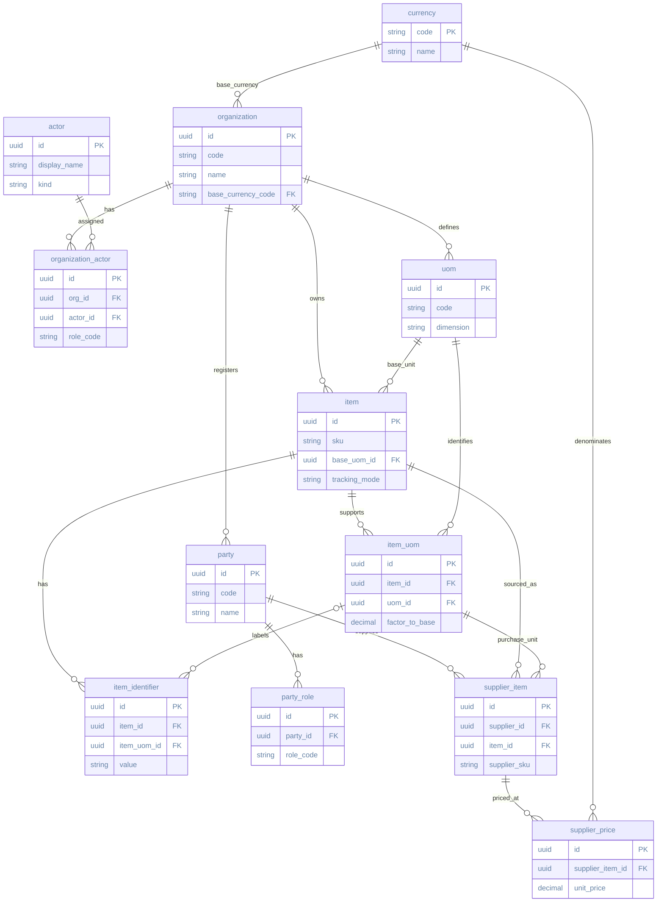
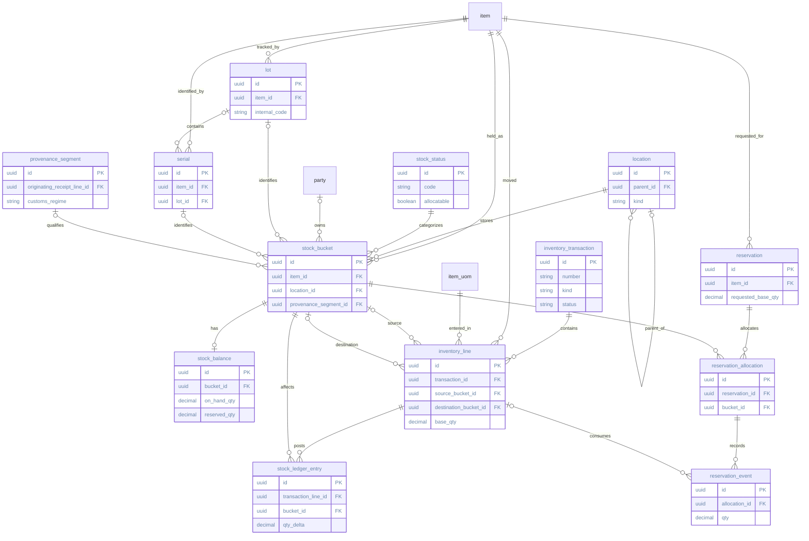
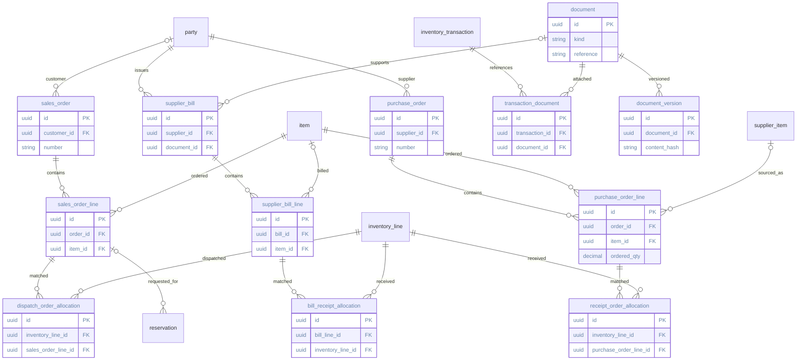
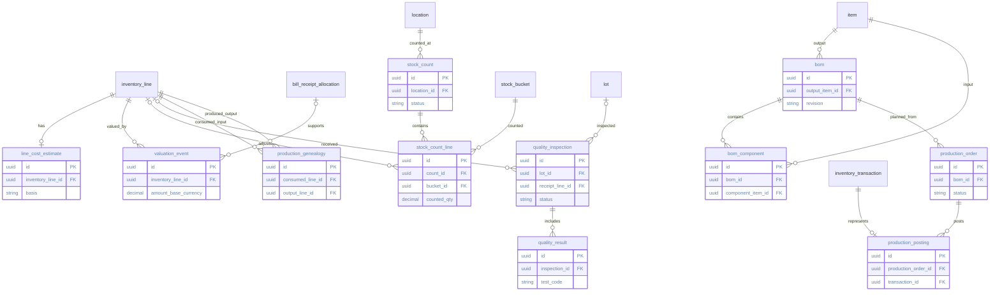
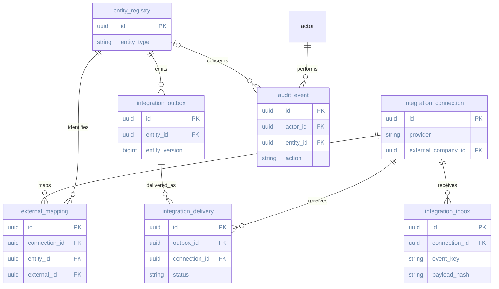
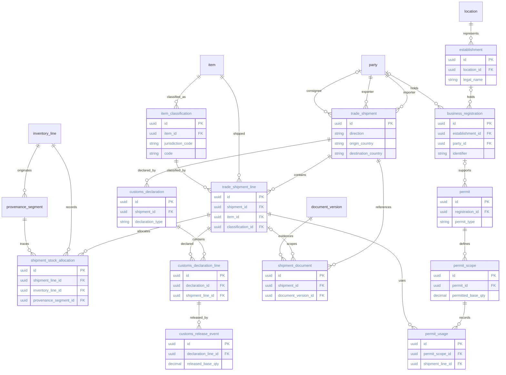
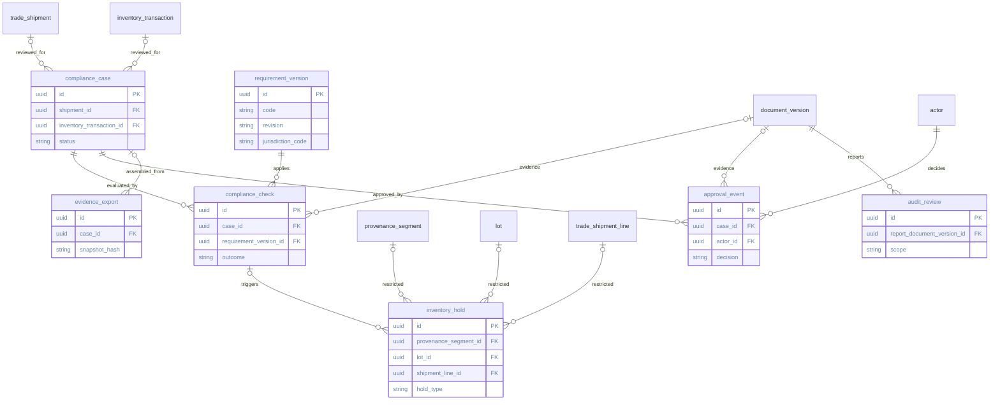

# Proposed table relationships

<!-- reading-sequence:start -->
[Previous: Table and column audit](schema-audit.md) | [Next: Posting and ERP integration](posting-and-integration.md)
<!-- reading-sequence:end -->

[Documentation index](../README.md) | [Project home](../../README.md) | [Table and column audit](schema-audit.md) | [Schema proposal](database-schema.md) | [Trade design](compliance-and-trade.md)

These diagrams describe the **proposed design**, not an applied PostgreSQL schema. They are split by domain and show selected identifiers and relationships. For the complete column inventory, see the [table and column audit](schema-audit.md). The [posting contract](posting-and-integration.md) describes concurrency and business invariants that diagrams alone cannot enforce.

In Mermaid notation, `||` means exactly one, `o|` zero or one, and `o{` zero or many. Each line describes a relationship in both directions: for example, `organization ||--o{ item` means one organization can have many items, and each item belongs to exactly one organization. Optionality and cardinalities are draft interpretations of the dictionary, not verified constraints. Links to common `org_id`, `created_by` and other shared metadata are omitted from most diagrams to keep them readable; organization-owned foreign keys are intended to include `org_id` for cross-organization integrity. Currency is global.

## 1. Organization, catalog and suppliers

`party` represents an organization or individual in a business relationship. `party_role` records whether it acts as a supplier, customer or manufacturer. An item can have different supplier codes and units without duplicating its internal SKU.

## 2. Physical stock, movements and reservations

`stock_bucket` identifies a position; `stock_balance` is a maintained projection; `stock_ledger_entry` records posted movements. Source and destination buckets are optional separately, but a line needs at least one. An internal transfer needs both. A `provenance_segment` keeps stock with distinct provenance or customs treatment from being merged; its creation cycle with receipt lines is unresolved.

**Provenance note:** the addendum requires a segment for tracked trade stock and proposes an ordinary segment for domestic stock. The base dictionary originally made no such link. Whether every bucket must have a segment, and how an opening or produced segment is created, remains under review; the diagram uses the most permissive unresolved cardinality.

## 3. Orders, optional bills and documents

A receipt line can be linked to an order and a bill later. A physical transaction can exist without any bill or document. Allocation tables support partial and split matching.

Document file metadata overlaps between `document` and `document_version`; the final boundary needs review before implementation.

## 4. Counts, valuation, quality and manufacturing

Production consumption and output use inventory lines. `production_genealogy` links inputs to outputs, while the longer-term segment-level lineage needed for cross-border cases still requires design. The separate `quality_inspection` targets are optional individually, with at least one required.

## 5. ERP integration and audit

Mappings connect internal identities to external IDs. Inbound events and outbound deliveries support retries and reconciliation; they do not guarantee exactly-once delivery. The generic `entity_registry` is a proposed design choice and remains open to review.

## 6. Shipments, customs and permits

Classification, registration and clearance are shipment- and jurisdiction-dependent. A customs declaration is evidence about a shipment; a document or stock receipt alone does not establish clearance. The direct declaration-line-to-shipment-line relationship below reflects the present draft, but must be replaced or extended with an allocation table where many-to-many matching is needed.

`business_registration` has two optional subject references, with exactly one required by the proposal. Receipt provenance for opening stock and production output needs clarification; the displayed origin relationship is the current draft, not a settled universal requirement.

## 7. Compliance cases, holds and review evidence

A compliance case can reference a shipment or a physical transaction. Checks, approvals and holds are scoped records; no single status represents all quality, customs and documentation requirements. Hold event history, partial quantities and detailed auditor findings remain unspecific in the draft.

## Relationship decisions still open

- **Authorization:** role assignments exist, but permissions and site scope tables are not yet specified.
- **Provenance cycle:** a receipt line, its provenance segment and its destination bucket can depend on each other; define creation order and constraints before migration.
- **Documents:** resolve duplicated file fields between logical documents and immutable versions.
- **Customs allocation:** define the many-to-many declaration-line allocation table, quantities and keys; the current direct link is provisional.
- **Holds:** define event history, releases, partial quantities and concurrency guards before relying on holds.
- **Manufacturing lineage:** decide how multiple consumed provenance segments map to output segments without assuming automatic country-of-origin conclusions.
- **Audit coverage:** common audit fields and business-event actors have different possible meanings; the full immutable audit/control model is not settled.
- **Cardinality and nullability:** trade and compliance proposals contain incomplete details. Review them table by table before treating these diagrams as executable constraints.

<!-- reading-sequence:start -->
[Previous: Table and column audit](schema-audit.md) | [Next: Posting and ERP integration](posting-and-integration.md)
<!-- reading-sequence:end -->
